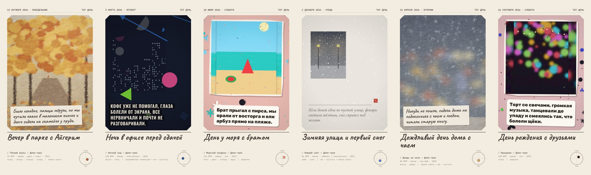

# Тот день

Личный дневник, который превращает один день (текст, фото и песню) в анимированную страницу с атмосферой этого дня. Каждый день лежит в своей папке с названием, которое система придумывает сама.

Прототип для RecGenesis Hackathon, трек ArtTech, кейс «Make the Invisible Visible».



## Запуск

Нужен любой статический сервер (из-за `fetch` для демо-дней). Из корня репозитория:

```bash
python3 -m http.server 8000
```

Откройте http://localhost:8000. На пустом архиве нажмите «Загрузить 6 примеров» или «Записать первый день».

Тот же код работает на GitHub Pages: репозиторий можно опубликовать как есть (Settings → Pages → ветка `main`, папка `/`), сборка не нужна. Работает без интернета: шрифты лежат в `fonts/`, анализ идёт в браузере.

## Поиск песни на YouTube по названию (по желанию)

Кнопка «Найти на YouTube по названию» работает и без настройки: открывает поиск YouTube в новой вкладке. Чтобы видео показывались прямо в форме, нужен бесплатный ключ YouTube Data API (около 10 минут):

1. Откройте [console.cloud.google.com](https://console.cloud.google.com/) и создайте проект с любым названием.
2. **APIs & Services → Library**: найдите **YouTube Data API v3** и нажмите **Enable**.
3. **APIs & Services → Credentials → Create credentials → API key**.
4. Откройте созданный ключ. **Application restrictions → Websites**, добавьте адрес сайта: `https://sas1k00.github.io/*` (для проверки на своём компьютере можно добавить и `http://localhost:8000/*`).
5. **API restrictions → Restrict key**: только **YouTube Data API v3**. Сохраните. Ограничения начинают действовать через несколько минут.
6. На GitHub откройте файл `js/config.js`, нажмите карандаш (Edit), вставьте ключ между кавычками: `youtubeApiKey: 'AIza…',` и сохраните изменение (Commit changes) в `main`.

Ключ в браузерном приложении всегда виден в коде страницы, поэтому шаги 4–5 обязательны: ключ будет работать только на этом сайте и только для поиска на YouTube. Бесплатная квота — 10 000 единиц в день, один поиск стоит 100, то есть около 100 поисков в день. Когда квота кончается, кнопка снова открывает поиск в новой вкладке.

## Сценарий

1. **Запись.** Дата, текст о дне (русский, казахский или вперемешку), 1–6 фото, песня: ссылка (YouTube, Spotify, Яндекс Музыка, Apple Music, SoundCloud) или аудиофайл. **Название, исполнитель, год и жанр подставляются сами** по ссылке (YouTube, Spotify, SoundCloud, Apple Music) или по имени файла «Исполнитель - Название»; год — первый выпуск песни, а не поздний сборник; введённое вручную не перезаписывается. **Два касания о песне:** спокойная или энергичная, светлая или грустная. Для ссылки это главный способ, которым песня влияет на страницу, поэтому форма один раз переспросит, если их пропустить; на странице дня без ответов можно ответить и пересобрать день. По желанию: жанр, год, темп или «отстучать ритм», погода.
2. **Сборка.** Правила читают текст, фото и звук и собирают страницу 9:16. Справа видно, почему день выглядит именно так.
3. **Папка дня.** Название из 3–7 слов. «Папка дня .zip» скачивает папку: запись, фото, песня, обложка, видео (если записано), настройки голоса, правила оформления.
4. **Просмотр.** Страница играет под песню, кадры меняются точно в долю. Звучит не вступление, а **момент песни** на 30 секунд: для аудиофайла система находит его сама (часть, которая повторяется, как припев, с громкостью под энергию дня, с начала новой части песни, ровно в долю); для YouTube берёт время из ссылки («Поделиться → Начало») или поле «Любимый момент». YouTube и страница запускаются одной кнопкой и идут синхронно.
   **«Выбрать на слух» / «Выбрать момент»** открывает окно прямо в приложении: песня (аудиофайл или сам ролик YouTube), линия всей песни со светлым отрезком на 30 секунд, кнопка «Это мой момент» во время прослушивания, ±5 секунд, «Послушать момент». Для файла на линии видна громкость песни и пунктиром предложение системы. Выбор ставится ровно в долю. Работает в форме и на странице дня. «Озвучить запись» читает текст голосом, подобранным правилами, музыка в это время приглушается.
5. **Архив и лента.** Архив — полка дневника: все дни в одной сетке, первый день месяца с бумажной наклейкой-месяцем, карточки вклеены под своим углом. «Лента» — плёнка: дни-кадры листаются вбок для проверки цельности. Пока день собирается, его фото «проявляется», как полароид; при открытии дня обложка вырастает в страницу (View Transitions, в браузерах без них — обычный переход). С настройкой «уменьшить движение» анимации выключены.

## Проверка

```bash
node tests/run.js        # 97 тестов правил: названия, поездки, «пик и финал», казахский текст, музыка, два касания, момент песни, визуальная система, смешанные дни, ZIP
python3 -m http.server 8765 &   # затем:
node tests/e2e.js        # браузерный тест: 6 демо-дней, лента, ZIP, форма со ссылкой, телефон
```

`e2e.js` использует Playwright (`npm i playwright`, если его нет).

## Устройство

| Файл | Что делает |
|---|---|
| `js/lexicon.js` | Словари: ~260 основ слов о чувствах (рус/англ), места, люди, детали, события, время суток, сезоны, погода |
| `js/text.js` | Чтение записи: настроение по правилу «пик и финал» (конец дня и самый сильный момент весят больше, поворот на «но / а потом»), «впервые», энергия, «тепло», отрицания и усилители, места (≈165 стран и городов: куда ездят из Казахстана — Турция, ОАЭ, Египет, Вьетнам, Таиланд, Мальдивы, Грузия, умра — и самые посещаемые места мира — Рим и Ватикан, Париж, Барселона, Лондон, Нью-Йорк, Сингапур…; около 20 знаменитых достопримечательностей — Колизей, Треви, Эйфелева башня, Саграда Фамилия; плюс любое название с большой буквы после «в/на/до»), что там любят (рафтинг, снорклинг, шар над Каппадокией, фо, хинкали…), поездки и транспорт, подпись |
| `js/naming.js` | Название папки по шаблонам, 3–7 слов, грамматически согласованное |
| `js/photo.js` | Палитра k-means, яркость, насыщенность, контраст, теплота фото; где на фото главное (люди, детали), чтобы его не обрезать |
| `js/music.js` | Анализ звука: FFT, темп по автокорреляции с уточнением вместе с фазой доли (по басу и бочке; на тестовых песнях сетка долей попадает в настоящие доли в среднем с точностью 19 мс), мажор/минор по профилям Крумхансла, громкость, яркость; **момент песни** (матрица самоподобия для повторов, границы частей песни, привязка к доле); описание песни для ссылок; время старта из ссылки YouTube |
| `js/system.js` | Визуальная система: правила, превращающие анализ в приём, цвет, ритм, композицию, фактуру, шрифт и голос, с объяснением каждого решения. Мягкие границы между приёмами и второй приём для смешанных дней |
| `js/render.js` | Отрисовка страницы на Canvas 2D: четыре приёма, погода, плёнка, постоянная рамка дневника |
| `js/songinfo.js` | Название, исполнитель, год и жанр песни по ссылке: oEmbed YouTube / Spotify / SoundCloud, поиск iTunes; самый ранний год у того же исполнителя |
| `js/config.js` | Настройки, которые можно заполнить самому: ключ YouTube Data API для поиска песни по названию |
| `js/moment.js` | Окно «Момент песни»: прослушивание, линия песни с громкостью, «Это мой момент», привязка к доле; загрузка YouTube IFrame API |
| `js/store.js` | Архив в IndexedDB и ZIP «папки дня» |
| `js/voice.js` | Озвучка через Web Speech API |
| `js/app.js` | Интерфейс: архив, лента, новая запись, страница дня, правила |
| `tests/synth-song.js` | Тестовая песня на 2 минуты с известной структурой (вступление, куплеты, три припева, бридж) для проверки момента песни |
| `tools/make_demo_assets.py` | Генерирует демо-фото и демо-песни кодом (без чужих авторских прав) |

## Инструменты и ресурсы

- Открытые API для данных о песне: oEmbed YouTube, Spotify и SoundCloud, iTunes Search API (Apple). Без ключей.
- Без фреймворков и без ИИ. Чистый JavaScript, Canvas 2D, Web Audio API, Web Speech API, IndexedDB, MediaRecorder.
- Шрифты Google Fonts (SIL Open Font License): Caveat, IBM Plex Mono, Oswald, Rubik, Cormorant Garamond, с наборами cyrillic-ext для казахских букв (ә, ғ, қ, ң, ө, ү, һ).
- Профили тональностей Krumhansl–Kessler (1982), опубликованные данные.
- Демо-фото и демо-песни сгенерированы скриптом `tools/make_demo_assets.py` (Python, NumPy, Pillow). Для настоящей демонстрации замените их своими.
- Тесты: Node.js и Playwright.
- Код написан командой с помощью ИИ-ассистента для программирования (Claude Code).

## Ограничения (честно)

- Словарь работает по основам слов, без морфологии: сарказм и сложные обороты может прочитать неверно. Похожие слова разведены списком исключений («поездка» ≠ «поезд», «холодильник» ≠ холод, «тауық» ≠ «тау»), но список не полный.
- Казахский и смешанный текст: около 70 слов о чувствах, отрицание («қуанбадым», «жақсы емес»), люди («ағаммен» → «с братом»), места, праздники (Наурыз, той), еда. Словарь меньше русского, поэтому казахская запись читается грубее. Названия папок всегда на русском: у дневника один голос.
- Мажор/минор по звуку верен в 4 из 6 тестовых песен: путает параллельные тональности. Поэтому ответ пользователя «песня светлая/тёмная» главнее анализа.
- Песни по ссылке не анализируются как звук: браузер не даёт доступа к звуку чужого сайта, а скачивать песню с YouTube нельзя по его правилам и по правилам кейса. Влияние идёт через описание (жанр, год, темп, настроение) или отстуканный ритм, а момент песни выбирает человек.
- Видео дня с песней с YouTube записывается со звуком только в Chrome на компьютере: браузер спросит разрешение записать вкладку, нужно отметить «Поделиться звуком вкладки». В других браузерах видео получится без музыки. Синхронизация с YouTube проверена только на запасном пути (без доступа к YouTube); на живом YouTube её нужно проверить перед демо.
- Голос озвучки зависит от браузера и ОС; записать его в файл браузер не позволяет, поэтому в папке хранятся его настройки.
- Данные живут в одном браузере. Нет аккаунтов и синхронизации. Наружу уходит только ссылка на песню и её название: в YouTube / Spotify / SoundCloud и в поиск iTunes, чтобы подставить исполнителя, год и жанр, а при поиске по названию — в поиск YouTube (Google). Текст, фото и файлы остаются у пользователя.
- Яндекс Музыка не отдаёт название по ссылке: его нужно вписать. Для Spotify исполнитель угадывается по названию (самая издаваемая песня с таким названием), форма просит проверить.
- Оценка настроения — подбор оформления, а не психологическая диагностика.
